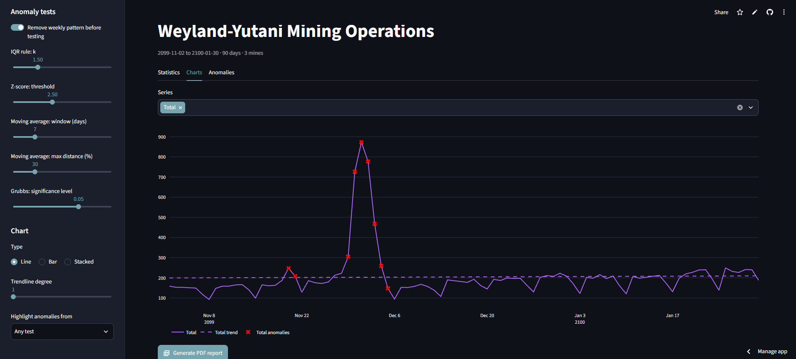
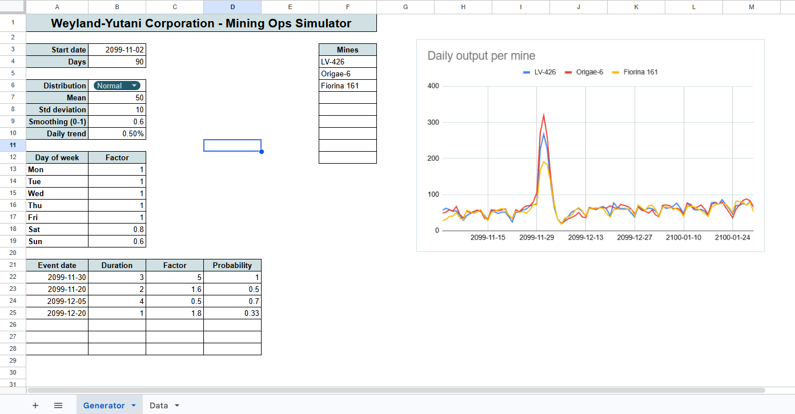
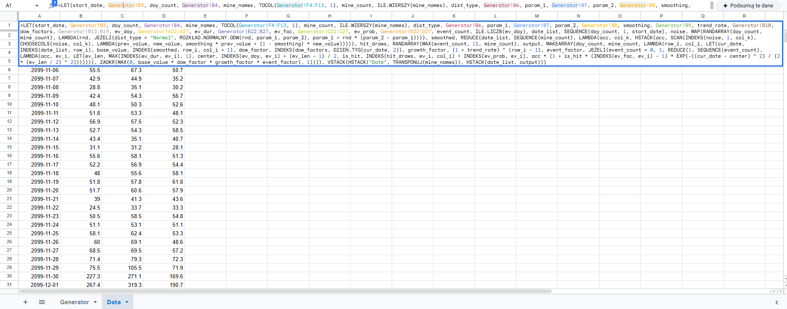
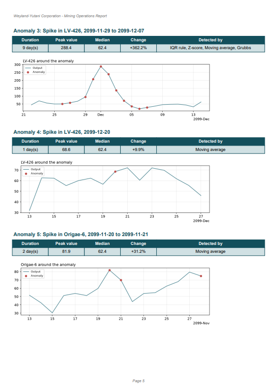

# Weyland-Yutani Mining Dashboard

A Google Sheets **data generator** creates realistic daily output for a fictional mining company: trends, weekly patterns and random incidents, all from one formula. This dashboard reads the generated data live, finds unusual days and turns them into a PDF report.

[🚀 Live app](https://weyland-yutani-mining.streamlit.app) · [📊 Data generator](https://docs.google.com/spreadsheets/d/1FkrTgr1sRXpvhPpsQqCinUWLUbuzJiUEwYtTBpZno3Y) · [🎥 Video](https://youtu.be/O-3xZS9Gy4U)

## What it does

- **Generates data:** change a few settings in the sheet and new data appears.
- **Shows the numbers:** key statistics for every mine and for the total.
- **Finds anomalies:** four statistical tests mark unusual spikes and drops.
- **Draws charts:** with a trendline and anomalies highlighted.
- **Creates a PDF report** with one click.

### Data generator

### PDF report

Full sample: [`sample_report.pdf`](sample_report.pdf)

## Tech

Python, Streamlit, pandas, SciPy, Plotly, Matplotlib, fpdf2, Google Sheets (`LET`, `LAMBDA`, `MAP`, `SCAN`, `REDUCE`, `MAKEARRAY`)

## Run locally

    pip install -r requirements.txt
    streamlit run app.py